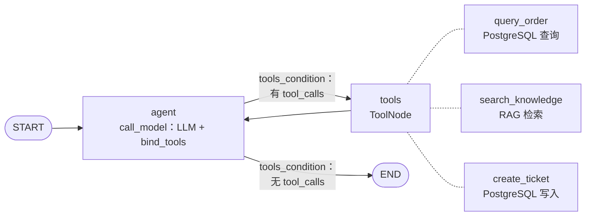
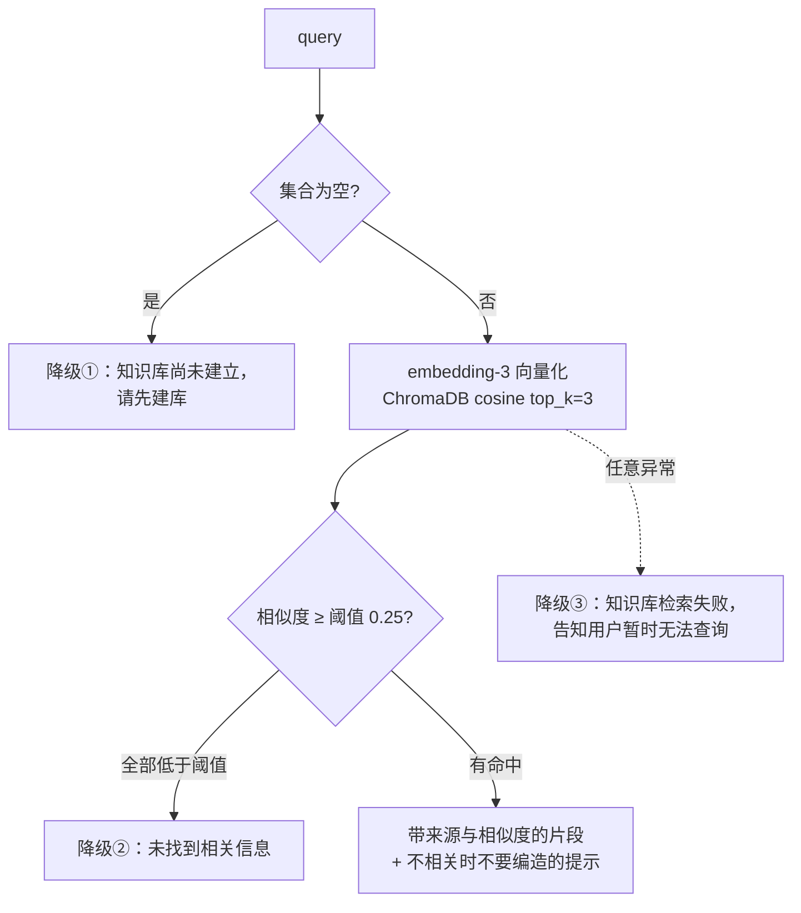
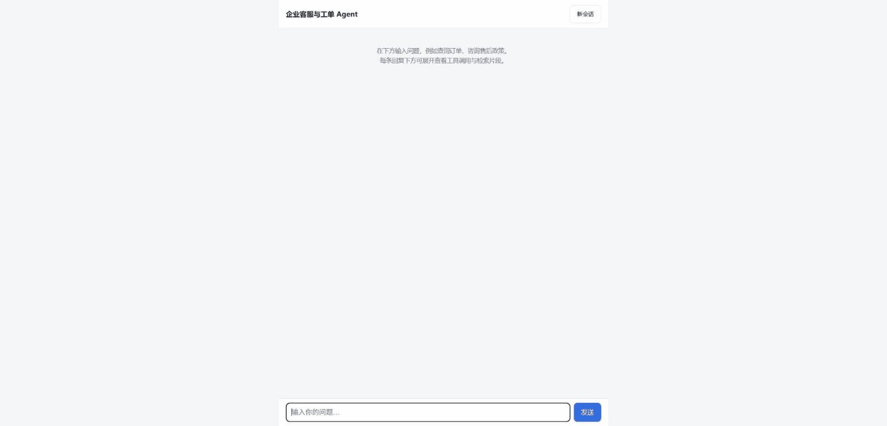

# 企业客服与工单 Agent

基于 LangGraph 的电商售后客服 Agent。它能查订单和物流、检索售后政策知识库，并在需要人工介入时创建工单；支持多轮会话，会话持久化在 PostgreSQL。

**它要解决的问题**：客服 Agent 最常见的失败，一是乱调工具（用户只是查物流，Agent 却自作主张建了工单），二是知识库里没有答案时编造政策。本项目手写 ReAct 状态图，RAG 加了阈值过滤和降级处理，再用 23 个自动化评测用例把这些行为量化。

## 核心结果

评测集共 23 个用例，分 5 类，用真实 LLM 运行（历史运行，结果文件中记录的模型名为 `deepseek-v4-flash`，temperature=0）。当前演示和后续运行使用 `deepseek-flash`（DeepSeek 接口当前接受的名字）：

| 轮次 | 通过率 | 来源 |
| --- | --- | --- |
| 调优前基线 | 87%（20/23），失败用例：tool_select_003、tool_select_005、memory_002 | `evals/results/eval_20260830_183442.json` |
| 最新一次 | **100%（23/23）** | [`evals/results/eval_20260830_202922.json`](evals/results/eval_20260830_202922.json) |

最新一次的分类结果（同一个文件 `eval_20260830_202922.json` 的统计）：工具选择 6/6、边界拒绝 4/4、多轮记忆 4/4、RAG 检索 4/4、鲁棒性 5/5。

3 个失败都出在"何时建工单"，但方向相反：tool_select_005 在用户只是查物流时主动建了单；tool_select_003、memory_002 在用户明确要求建单时没有建（改去检索知识库）。docs/tuning-log.md 把原因归为 prompt 里建单时机的策略缺失，改 prompt 后下一轮为 23/23，但 tool_select_003 在之后的一轮又失败过，随后补充了规则。每一轮的失败分析和修复过程见 [docs/tuning-log.md](docs/tuning-log.md)。

## 架构

### Agent 状态图（[agent.py](agent.py)）



`POST /chat` 的流程（[main.py](main.py)）：先用 `db.load_history` 取出该会话最近的 N 条消息（N 由 `MAX_HISTORY_MESSAGES` 设置，默认 10），再与本轮用户消息拼接后执行 `agent.ainvoke`，最后 `db.save_message` 只存用户消息和最终回复。响应里会附带本轮的工具调用轨迹。

### RAG 检索与三层降级（[rag.py](rag.py) `search()`）



`search()` 永远不抛异常，三种降级都以文字形式交给 Agent，由 Agent 组织回复。切分逻辑是自己写的：先按标题和空行切出自然段，再贪心合并到 350 字，单段过长时用滑动窗口硬切，重叠 60 字。知识库原文在 `knowledge/`，共 13 篇售后政策。

## 技术栈

- **Agent**：LangGraph（手写 `StateGraph`）、LangChain `ChatOpenAI`，可接任意 OpenAI 兼容模型
- **RAG**：ChromaDB（直接用原生 API）、智谱 `embedding-3`（用 httpx 直调 `/embeddings` 接口）
- **服务**：FastAPI（异步）、Uvicorn
- **持久化**：PostgreSQL、SQLAlchemy 2.0 async、asyncpg
- **部署**：Docker Compose

## 快速开始

### 方式一：Docker Compose（推荐）

```bash
cp .env.example .env
# 编辑 .env，至少填写：LLM_API_KEY、LLM_BASE_URL、LLM_MODEL_NAME、EMBEDDING_API_KEY、POSTGRES_PASSWORD
docker compose up --build
```

容器启动时会依次完成三件事：用 `scripts/seed_data.py` 灌入模拟订单（幂等）、用 `scripts/build_kb.py` 构建知识库（幂等）、启动 API。

```bash
# 端口以 .env 里的 APP_PORT 为准，默认 8000
curl http://localhost:8000/health
curl -X POST http://localhost:8000/chat -H "Content-Type: application/json" \
     -d '{"message": "我的订单9527为什么还没到？"}'
```

**ChromaDB 数据的持久化**：向量库保存在命名卷 `chroma_data` 中，第一次启动时调用 embedding 接口建库，之后的启动检测到已有数据就跳过。如果没有配置 embedding key，建库失败也不影响服务启动，只是检索会返回"知识库尚未建立"。补好配置后执行；建库因网络失败时，同样用 `--rebuild` 重试：

```bash
docker compose exec app python scripts/build_kb.py --rebuild
```

### 方式二：本地运行

Dockerfile 使用 Python 3.12.10；本地评测在 3.12 上运行过。另需一个可用的 PostgreSQL。

```bash
pip install -r requirements.txt
cp .env.example .env              # 填写 LLM_* / EMBEDDING_*，并必须设置 DATABASE_URL（未设置时启动即报错）
python scripts/seed_data.py       # 灌入模拟订单
python scripts/build_kb.py        # 构建向量库到 ./chroma_db
uvicorn main:app --reload
```

### 离线测试（不需要 API key）

```bash
python test_agent.py
```

测试用脚本化的假 LLM 验证状态图的流转（agent → tools → … → END）和会话窗口逻辑。它需要连接 PostgreSQL（必须通过环境变量 `DATABASE_URL` 提供连接串，未设置会直接报错），并且会真实写入一张测试工单。

演示页的 Markdown 渲染（先转义，只支持加粗、列表、换行、行内代码）有单独的测试，需要 Node 18+：

```bash
node web/markdown.test.js
```

## 演示

服务启动后浏览器打开 <http://localhost:8000/>（端口以 `APP_PORT` 为准）即可使用演示界面：一个原生 HTML + JS 的单页（[`web/index.html`](web/index.html)），没有前端框架和构建步骤，由 FastAPI 在根路径提供。每条回复下方的"查看执行详情"可以展开，显示本轮调用了哪些工具（工具名、参数、返回摘要）和检索到的知识库片段（文件名、相似度、是否触发降级）。

<!--  -->

演示使用的模型：

- 对话模型：deepseek-flash（作者按录制时 `.env` 里的 `LLM_MODEL_NAME` 填写）
- Embedding 模型：embedding-3（`.env.example` 的默认值是智谱 `embedding-3`；录制时若改过 `EMBEDDING_MODEL_NAME` 以实际为准）

> `docs/demo.gif` 由作者录制后放入，在此之前上图不显示。演示用的 4 条对话和预期现象见 [docs/demo-script.md](docs/demo-script.md)。

界面所需的检索信息来自 `POST /chat` 响应里新增的 `retrievals` 字段（`query`、`status`、`degraded`、`hits[source, similarity, snippet]`）。`status` 取值 `hit` / `not_found`（全部低于阈值）/ `kb_not_built` / `error`（检索异常，如 embedding 接口或网络故障）/ `unknown`（输出格式无法识别，此时 `degraded` 为 `null`）。它由 `search_knowledge` 的输出文本解析而来（见 `retrieval_trace.py` 的 `parse_retrieval`），原有字段不变；被相似度阈值过滤掉的片段不会出现在其中。

## 复现评测

```bash
python evals/run_eval.py                                     # 全部 23 个用例
python evals/run_eval.py boundary                            # 只跑某一类
python evals/run_eval.py --cases evals/holdout_cases.json    # 指定用例文件，默认 evals/cases.json
```

- 需要两个 key：一个 OpenAI 兼容的对话模型 key（历史结果文件记录的模型是 `deepseek-v4-flash`），以及一个**智谱开放平台 key**（给 `embedding-3` 用），还要先建好知识库和种子数据。
- 评测会调用真实模型并产生费用，也会真实写入工单（运行结束会报告新建的 ticket_id）；评测用的会话历史会自动清理。
- 每次运行的结果保存在 `evals/results/eval_*.json`，最新的报告是 `latest_report.md`。用例定义在 `evals/cases.json`。`python evals/summarize_results.py` 会把 `results/` 下全部运行记录汇总成表格（[docs/tuning-log.md](docs/tuning-log.md) 末尾的附录就是它生成的）。
- `--cases`：非默认用例集的结果文件以用例集文件名为前缀（如 `holdout_cases_<时间>.json`），报告为 `<用例集名>_latest_report.md`，不会覆盖调优集的结果。
- `--ids a,b`：只重跑指定用例，**只用于重跑检索状态为 `error` 的用例**（embedding 接口或网络故障等基础设施问题，规则见 [evals/HOLDOUT.md](evals/HOLDOUT.md)）。重跑的结果文件带 `_rerun` 后缀（如 `holdout_cases_rerun_<时间>.json`），报告为 `*_latest_report_rerun.md`；新旧两份结果都保留，不覆盖完整运行。
- 结果文件里每个用例新增了三个只用于留档、不参与判定的字段：`tool_outputs`（每次工具调用的返回，原文只保留前 500 个字符，并带 `output_chars` / `truncated`）、`retrievals`（每次 `search_knowledge` 调用的结构化解析：`status` / `degraded` / `hits`）、`retrieval_status_counts`（5 种检索状态各出现几次）。`meta` 里相应增加 `cases_file`、`ids`、`retrieval_error_ids`、`retrieval_unknown_ids`。这样可以区分"相似度低于阈值的降级（`not_found`）"和"检索调用异常（`error`）"。此前的 8 个历史结果文件没有这些字段。

## 验证集

上面 23 个用例由作者编写并参与过调优（改过 prompt，也改过一个用例的断言），100% 只能说明调优目标达成。为了看没调优过的问法表现如何，另有一组 10 个**不参与调优**的验证用例：[`evals/holdout_cases.json`](evals/holdout_cases.json)，覆盖退换货、运费、物流异常、发票、保修、订单不存在、知识库里没有答案、缺信息的模糊提问、越权和政策之外的要求。

- 通过率：**待填（由作者运行后填写）**
- 运行方式：`python evals/run_eval.py --cases evals/holdout_cases.json`（结果文件前缀为 `holdout_cases_`，不覆盖调优集的结果）
- 使用规则、局限（样本只有 10 个、用例作者读过 prompt 与知识库、关键词断言较宽松）和"若因验证集失败改了 prompt / RAG / 工具，这批用例即降级为调优集"的约定见 [evals/HOLDOUT.md](evals/HOLDOUT.md)。

## 已知局限与下一步

- 评测规模小：23 个用例，只测了一个模型。回复断言用的是关键词包含，比较宽松；历史上出现过偶发失败（tool_select_003、rag_001），见 `evals/results/` 中的历史记录。
- RAG 方案比较基础：按字符长度切分，没有 rerank 和混合检索；相似度阈值 0.25 是经验值，验证情况见下一条。
- 相似度阈值 0.25 没有用无关问题的真实相似度分布验证过。机制上（见 `rag.py` 的 `search()`），检索固定取 top_k=3，只按阈值过滤：只要有片段分数超过 0.25，即使问题与知识库内容无关，这些片段也会交给模型。演示时对"你们支持分期付款吗？"（`knowledge/` 中没有该内容）实际检索了一次（对话模型 `deepseek-flash`，embedding 为智谱 `embedding-3`）：返回 3 个无关片段（发票政策 0.58、价保规则 0.55、退货政策总则 0.54），均高于阈值 0.25，未触发"未找到"降级；但模型最终回复明确说明知识库中没有分期付款的规则，没有编造。这只是单个问题的观察：它说明 0.25 在这个问题上起不到过滤作用，目前防编造主要靠提示词和模型本身；阈值整体表现仍未验证，计划用一批无关问题统计相似度分布后再标定。
- 会话只保存用户消息和最终回复，工具调用的中间过程不入库。API 没有鉴权。
- `test_agent.py` 依赖 PostgreSQL，不是纯单元测试。
- 下一阶段：执行 Trace 可视化、人工审批（HITL）。
- 计划：用本地 Ollama bge-m3 与智谱 embedding-3 做对照实验（尚未进行）。
